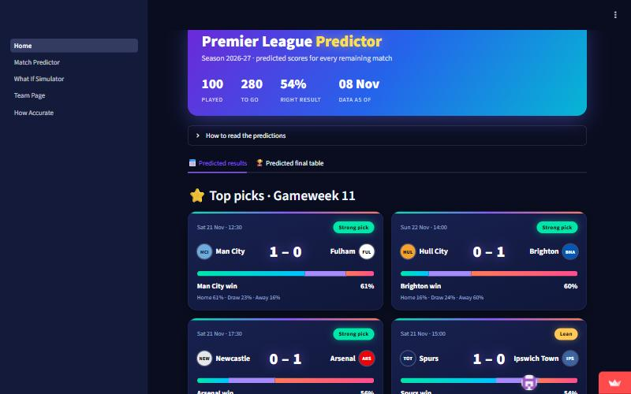
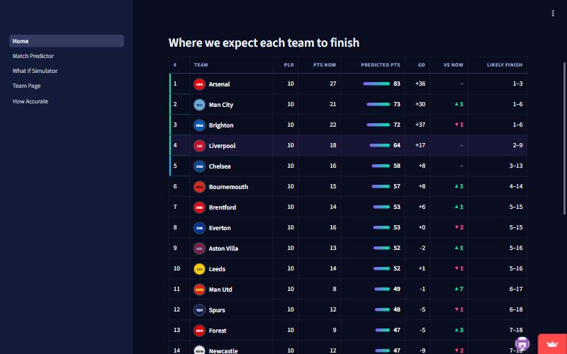
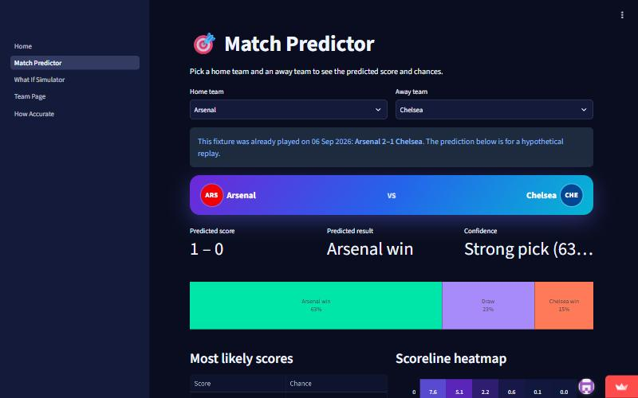
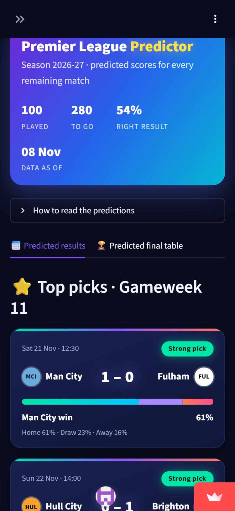

# ⚽ Premier League Predictor

[](https://github.com/senansul11/prem-predictor/actions/workflows/ci.yml)
[](https://epl26-27predictor.streamlit.app/)

[](LICENSE)

Predicted scores, win/draw/loss chances and a predicted final table for every remaining
Premier League match of 2026-27, in a mobile-friendly web app that **updates itself every morning**.

### 👉 [Open the live app](https://epl26-27predictor.streamlit.app/)

> For entertainment and educational purposes only. **Not betting advice.** The predictions use past
> results only: no injuries, line-ups, transfers or news.

<p align="center">
  
  
</p>
<p align="center">
  
  
</p>

## What it does
- **Match predictions:** a predicted score, result and confidence label (Strong pick / Lean /
  Toss-up) for every remaining fixture, with the full win/draw/loss split.
- **Predicted final table:** the rest of the season is played out 10,000 times to give expected
  points, a likely finishing range, and title / top-4 / relegation chances.
- **Match predictor:** pick any two teams for scoreline odds and a heatmap.
- **What-if simulator:** lock in results ("what if Fulham win at Arsenal?") and see how the table moves.
- **Team pages and an honest accuracy page** written for people who don't follow statistics.

## How good is it?
Everything below is a **walk-forward test**: each match is predicted using only information from
before it, on 2,000 Premier League matches from 2021 to now. Lower RPS (ranked probability score) is better.

| | Right result | RPS |
|---|---|---|
| Always pick the home team | 44.05% | 0.2319 |
| Elo ratings | 53.45% | 0.2020 |
| **This project** | **53.65%** | **0.2001** |
| Bookmaker odds, days before | 54.85% | 0.1954 |
| Bookmaker odds, at kick-off | 55.00% | 0.1942 |

It clearly beats naive baselines and is a little behind the betting market, which also knows about
injuries and team news. Details, calibration and ablations are in [`reports/`](reports/).

## How it works
1. **Data:** Premier League and Championship results, shots and odds from
   [football-data.co.uk](https://www.football-data.co.uk) (2015-16 onward), cleaned into one schema
   (three different CSV layouts, mixed date formats, club-name aliases). Upcoming fixtures come from footballdata.io.
2. **Model:** a **Dixon-Coles** goals model. Every team gets an attack and a defence strength; goals are
   Poisson with a home-advantage term and a low-score correction. Recent matches count more
   (exponential time decay), and a **shot-on-target-based xG proxy** is blended into the training
   target to reduce luck. Championship matches give promoted clubs a starting rating.
3. **Season simulation:** a vectorised Monte Carlo (10,000 seasons in about 2 seconds) samples every
   remaining scoreline, applies Premier League tiebreakers (points, goal difference, goals scored), and mixes
   in **parameter uncertainty** by re-drawing team strengths so the odds aren't overconfident.
4. **Evaluation:** walk-forward backtesting only; hyper-parameters are tuned on 2016-21 and scored once
   on 2021-27.

**Tried and dropped** (they did not beat the simple model on held-out seasons): a recent-form "momentum"
term, XGBoost with engineered features, team-specific home advantage, and post-hoc draw / goal-level
corrections. See [`reports/improvement_experiments.md`](reports/improvement_experiments.md).

## Automatic updates and data checks
A GitHub Action ([`refresh.yml`](.github/workflows/refresh.yml)) runs every morning at 07:00 UTC:
download new results and fixtures → stop if nothing changed → run the data checks → refit and
re-simulate → commit the new files in `data/outputs/` → the hosted app redeploys itself.

If **any check fails, nothing is published**, the app keeps the last good predictions, and an issue is opened:
- every club name is recognised (new clubs fail loudly);
- no duplicate matches, and no team plays twice on one day;
- goals are valid and agree with the file's own result column;
- the number of played matches never drops (guards against truncated downloads).

## Run it yourself
Python 3.11+ (examples use [uv](https://docs.astral.sh/uv/)):

```bash
git clone https://github.com/senansul11/prem-predictor.git
cd prem-predictor
uv venv --python 3.12 .venv
uv pip install --python .venv/bin/python -e ".[dev]"        # Windows: .venv\Scripts\python.exe
.venv/bin/python -m streamlit run app/Home.py               # the app, using the committed predictions
```

To rebuild the predictions from scratch (downloads the CSVs; fixtures need a free
[footballdata.io](https://footballdata.io) key in a `.env` file, see `.env.example`):

```bash
.venv/bin/python -m plpredictor.pipeline refresh --force
```

Checks: `pytest` and `ruff check .` (both run in CI). To host your own copy for free, see [DEPLOY.md](DEPLOY.md).

## Project layout
```
src/plpredictor/   data pipeline, Dixon-Coles / Elo / XGBoost models, season simulator, refresh
app/               Streamlit app (Home.py and pages/)
data/outputs/      predictions the app reads (committed, updated daily)
reports/           evaluation write-ups and charts
tests/             pytest suite (data cleaning, models, simulator, refresh gates, app pages)
.github/workflows/ CI and the daily refresh
```

## Limitations
- No injuries, suspensions, line-ups, transfers or managerial changes. Treat it as an informed guide.
- Football is noisy: even the single best scoreline is only about 10-13% likely.
- The title odds of a runaway leader can look high; the model only knows results so far.
- The fixture feed publishes the schedule in stages, so late-season fixtures show "date TBC" for now.

## Credits and licence
Results, shots and odds data from [football-data.co.uk](https://www.football-data.co.uk) (free to use
with credit). Fixtures from footballdata.io. Club badges in the app are simple colour-and-initials
circles, not official crests. This project is not affiliated with the Premier League or any club.

Code released under the [MIT licence](LICENSE).
