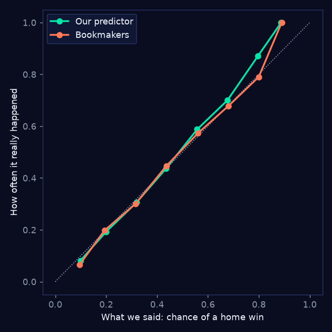

# Model evaluation

Generated by `python -m plpredictor.evaluation.ml_eval`. Lower RPS / log loss / Brier is better.
All numbers are **walk-forward** (each match predicted by a model that only saw earlier matches).
Hyper-parameters were tuned on validation seasons 2016-17 to 2020-21 only. The test seasons are
2021-22 to 2026-27 (the current season is partial: 100 matches).
Rows are restricted to matches that have both pre-closing and closing market odds so every
model is scored on identical matches (n = 2000).

## Headline comparison (test seasons)
| model | n | rps | log_loss | brier | accuracy |
|---|---|---|---|---|---|
| Market closing | 2000 | 0.1942 | 0.9585 | 0.5690 | 0.5500 |
| Market pre-closing | 2000 | 0.1954 | 0.9621 | 0.5717 | 0.5485 |
| XGB + pre-closing odds | 2000 | 0.1998 | 0.9800 | 0.5825 | 0.5290 |
| Blend DC+XGB (w_xgb=0.1) | 2000 | 0.2012 | 0.9797 | 0.5832 | 0.5300 |
| Dixon-Coles (walk-forward) | 2000 | 0.2012 | 0.9797 | 0.5832 | 0.5295 |
| Elo | 2000 | 0.2020 | 0.9835 | 0.5860 | 0.5345 |
| XGB raw (no calibration) | 2000 | 0.2035 | 0.9935 | 0.5913 | 0.5185 |
| XGB (all features, season-weighted, calibrated) | 2000 | 0.2047 | 0.9947 | 0.5926 | 0.5310 |
| XGB unweighted seasons | 2000 | 0.2048 | 0.9950 | 0.5930 | 0.5210 |
| XGB without momentum | 2000 | 0.2050 | 0.9957 | 0.5933 | 0.5265 |
| XGB without Elo | 2000 | 0.2056 | 0.9980 | 0.5947 | 0.5230 |
| XGB without Dixon-Coles features | 2000 | 0.2057 | 0.9981 | 0.5948 | 0.5265 |

Reading it: the **closing market** is the gold standard. The gap between our best model and the
market is the honest measure of what the model is missing (injuries, line-ups, news).

## RPS per test season
| season | Dixon-Coles (walk-forward) | Market closing | Elo |
|---|---|---|---|
| 2021-22 | 0.1933 | 0.1890 | 0.1966 |
| 2022-23 | 0.2074 | 0.1975 | 0.2024 |
| 2023-24 | 0.1895 | 0.1805 | 0.1913 |
| 2024-25 | 0.2033 | 0.1961 | 0.2040 |
| 2025-26 | 0.2112 | 0.2051 | 0.2136 |
| 2026-27 | 0.2072 | 0.2047 | 0.2089 |

## Blend weight (XGBoost share), chosen on validation seasons 2019-21
| w_xgb | val_rps | test_rps |
|---|---|---|
| 0.0000 | 0.2076 | 0.2012 |
| 0.1000 | 0.2074 | 0.2012 |
| 0.2000 | 0.2074 | 0.2012 |
| 0.3000 | 0.2076 | 0.2013 |
| 0.4000 | 0.2080 | 0.2015 |
| 0.5000 | 0.2086 | 0.2018 |
| 0.6000 | 0.2094 | 0.2022 |
| 0.7000 | 0.2104 | 0.2027 |
| 0.8000 | 0.2115 | 0.2033 |
| 0.9000 | 0.2129 | 0.2039 |
| 1.0000 | 0.2144 | 0.2047 |

Chosen weight: **0.1**. The test column is shown for transparency only; it was not used to choose.

## Dixon-Coles tuned settings
`{"xi": 0.002, "season_decay": 0.8, "ridge": 0.05, "w_e1": 0.5, "red_w": 1.0, "use_momentum": false, "max_goals": 10}`

Tuning log (validation RPS; one parameter at a time, see `data/outputs/dc_tuning.csv`):
| param | value | val_rps |
|---|---|---|
| xi | 0.0 | 0.20110 |
| xi | 0.0005 | 0.20027 |
| xi | 0.001 | 0.19976 |
| xi | 0.0015 | 0.19951 |
| xi | 0.002 | 0.19947 |
| xi | 0.003 | 0.19980 |
| xi | 0.004 | 0.20039 |
| ridge | 0.05 | 0.19780 |
| ridge | 0.15 | 0.19786 |
| ridge | 0.3 | 0.19796 |
| ridge | 0.6 | 0.19816 |
| ridge | 1.2 | 0.19851 |
| ridge | 3.0 | 0.19947 |
| season_decay | 1.0 | 0.19780 |
| season_decay | 0.9 | 0.19767 |
| season_decay | 0.8 | 0.19760 |
| season_decay | 0.7 | 0.19761 |
| w_e1 | 0.0 | 0.19897 |
| w_e1 | 0.25 | 0.19764 |
| w_e1 | 0.5 | 0.19760 |
| w_e1 | 1.0 | 0.19771 |
| red_w | 1.0 | 0.19760 |
| red_w | 0.5 | 0.19774 |
| use_momentum | False | 0.19760 |
| use_momentum | True | 0.19766 |

## Sanity checks of the goals model vs the market (test seasons)
| check | value |
|---|---|
| n | 1999.0000 |
| model_mean_total_goals | 2.8687 |
| actual_mean_total_goals | 2.9170 |
| model_mean_p_over25 | 0.5407 |
| market_mean_p_over25 | 0.5568 |
| corr_over25_model_vs_market | 0.7714 |
| corr_gd_model_vs_ah | 0.9420 |
| mean_gd_model | 0.2736 |
| mean_gd_market | 0.2849 |
| mean_gd_actual | 0.2696 |

## Feature importance (XGBoost, gain-based, fitted on all data to date)
| feature | importance |
|---|---|
| elo_diff | 0.1302 |
| dc_p_h | 0.1077 |
| dc_p_a | 0.0848 |
| dc_lam_h | 0.0451 |
| dc_p_d | 0.0357 |
| dc_lam_a | 0.0321 |
| elo_h | 0.0253 |
| v5_ppg_h | 0.0215 |
| f10_sh_h | 0.0206 |
| rest_a | 0.0206 |
| rest_h | 0.0205 |
| dc_att_h | 0.0202 |
| f10_sh_a | 0.0198 |
| mom_diff | 0.0195 |
| v5_ppg_a | 0.0189 |

## Calibration (P(home win))

## Data coverage (Premier League)
| season | rows | played | pct_xg | pct_pre_odds | pct_pinnacle_pre | pct_closing | pct_pinnacle_close | pct_over25 | pct_ah |
|---|---|---|---|---|---|---|---|---|---|
| 2015-16 | 380 | 380 | 0.0 | 100.0 | 100.0 | 100.0 | 100.0 | 100.0 | 100.0 |
| 2016-17 | 380 | 380 | 0.0 | 100.0 | 100.0 | 100.0 | 100.0 | 100.0 | 100.0 |
| 2017-18 | 380 | 380 | 0.0 | 100.0 | 100.0 | 100.0 | 100.0 | 100.0 | 100.0 |
| 2018-19 | 380 | 380 | 0.0 | 100.0 | 100.0 | 100.0 | 100.0 | 100.0 | 100.0 |
| 2019-20 | 380 | 380 | 0.0 | 100.0 | 100.0 | 100.0 | 100.0 | 100.0 | 100.0 |
| 2020-21 | 380 | 380 | 0.0 | 100.0 | 100.0 | 100.0 | 100.0 | 100.0 | 100.0 |
| 2021-22 | 380 | 380 | 0.0 | 100.0 | 100.0 | 100.0 | 100.0 | 100.0 | 100.0 |
| 2022-23 | 380 | 380 | 0.0 | 100.0 | 100.0 | 100.0 | 100.0 | 100.0 | 100.0 |
| 2023-24 | 380 | 380 | 0.0 | 100.0 | 100.0 | 100.0 | 100.0 | 100.0 | 100.0 |
| 2024-25 | 380 | 380 | 0.0 | 100.0 | 100.0 | 100.0 | 100.0 | 100.0 | 100.0 |
| 2025-26 | 380 | 380 | 0.0 | 100.0 | 55.3 | 100.0 | 55.3 | 100.0 | 99.7 |
| 2026-27 | 100 | 100 | 100.0 | 100.0 | 0.0 | 100.0 | 0.0 | 100.0 | 100.0 |

Notes: no `xG` before 2026-27, so v1 uses goals only. Pinnacle odds thin out during 2025-26 and
are missing in 2026-27, where the market average is used instead.
